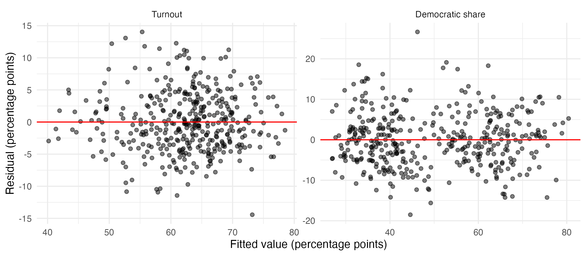
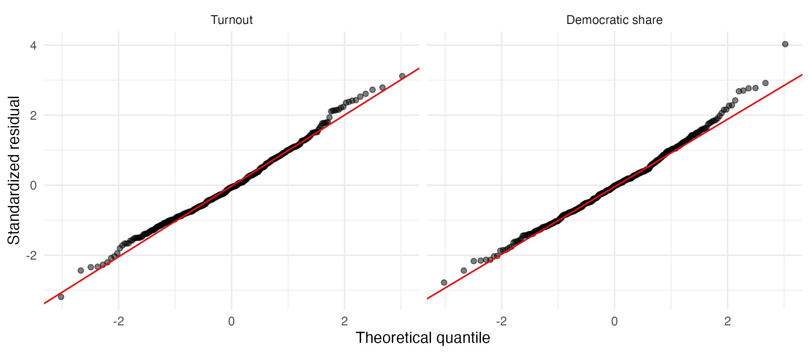
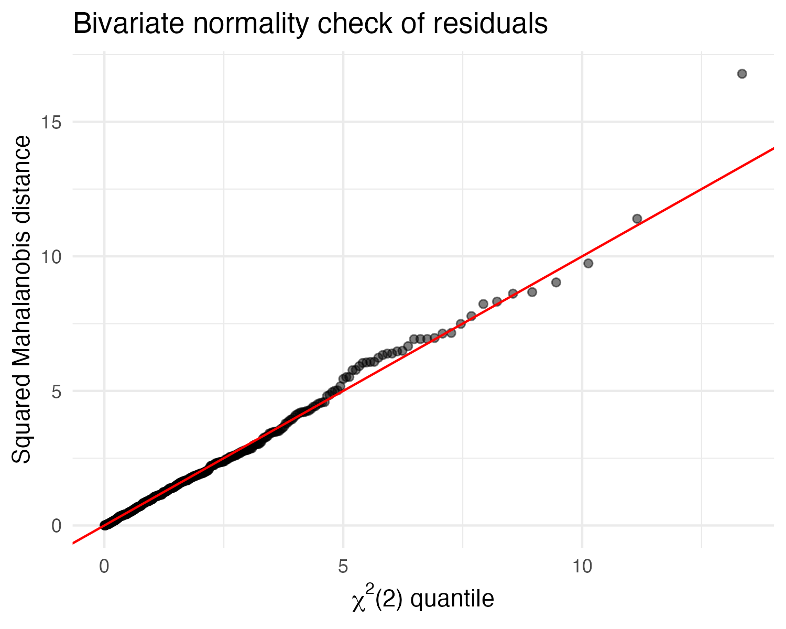

```{r}
#| label: setup
#| include: false
library(kableExtra)

# Read an exhibit exactly as written in the CSV, so values keep their
# intended decimals (one for percentages, two for income and density)
read_exhibit <- function(file) {
  read.csv(file.path("output/exhibits", file), check.names = FALSE,
           colClasses = "character")
}

# One style for every table in the report: true minus signs, a times sign
# in "Gini index x 100", en dashes in "18-29", numbers right-aligned, no
# automatic gap every five rows, and tables held where they appear in the text
style_table <- function(df, font_size = 9, scale_down = FALSE) {
  df[] <- lapply(df, function(col) {
    col <- gsub("(^|\\()-(?=[0-9.])", "\\1\u2212", col, perl = TRUE)
    col <- gsub(" x 100", " \u00d7 100", col, fixed = TRUE)
    gsub("18-29", "18\u201329", col, fixed = TRUE)
  })
  knitr::kable(df, format = "latex", booktabs = TRUE, linesep = "",
               align = c("l", rep("r", ncol(df) - 1))) |>
    kable_styling(font_size = font_size,
                  latex_options = if (scale_down) "scale_down" else "basic")
}
```

## Introduction

US politics has become more polarized and volatile in recent decades as illustrated by the more frequent changes in house majority; four times in the last 25 years (2006, 2010, 2018 and 2022) compared with only once in the previous 25 years (1994) [@wiki_house_stats]. In light of this volatility, this paper examines whether the demographic and economic characteristics of congressional districts are associated with House election outcomes. For a given number of eligible voters, the number of votes for a party's candidate depends on two components: the proportion of eligible voters who vote, and the share of those votes cast for the party. To identify characteristics associated with these components, this paper addresses three research questions:

- Which district characteristics are associated with turnout and the Democratic two-party vote share, taken together?
- Are these characteristics associated with turnout and Democratic share to the same degree?
- Does modeling the two outcomes jointly provide insights that separate models do not?

When these outcomes are modeled with univariate regression models, any correlation between turnout and vote share is ignored. To evaluate whether modeling the outcomes jointly provides additional insight, a multivariate regression model is also modeled on the data.

The data cover the 2024 House elections, which elected the 119th Congress. Election returns were obtained from the MIT Election Data + Science Lab [@MIT_house]; demographic and economic characteristics of each district from the Census Bureau's American Community Survey (ACS) 5-year estimates (2020–2024) [@census_acs5]; and land area from the Census Bureau's 2024 Gazetteer file [@census_gazetteer].[^repo]

Results suggest that turnout and Democratic share of the two-party vote are associated with district characteristics in different ways. The predictors explain most of the variation in turnout (70.9%) and Democratic share (82.0%), and the joint test that no predictor is associated with either outcome is rejected using Pillai's trace ($p < 0.001$). Nine of the twelve predictors are associated with the two outcomes by significantly different amounts. Since the residual correlation between the outcomes is near zero, the two approaches reach the same conclusion for 11 of 12 predictors (the exception is female share). The multivariate framework is most useful for directly testing whether each predictor's associations with turnout and Democratic share differ.

The remainder of this paper describes the data, summarizes the methods used evaluate outcomes, presents the results, discusses their implications and limitations, and concludes with potential follow-on research.

[^repo]: All R scripts, data and report files are available at
    <https://github.com/janblackbu69/Math257>.

## Data

The unit of analysis is the congressional district, using the 119th Congress districts from the November 2024 election, in which Democrats gained two seats to reach 215 while Republicans retained control with 220 seats [@wiki_house_stats]. The two outcome variables are turnout, calculated as the number of votes cast in the House race divided by the citizen voting-age population (CVAP), and Democratic share, calculated as Democratic votes divided by the sum of Democratic and Republican votes.

The model uses 396 of the 435 districts. The other 39 lacked either a Democratic or a Republican candidate. Twenty of the excluded districts are in Texas (8), Massachusetts (7) and California (5). 

The predictor variables describe the racial and ethnic, educational, income, age and sex composition of each district, its population density and the party of its incumbent (see Appendix A) with descriptive statistics shown in @tbl-descriptives. The non-Hispanic White share is omitted because it is nearly a linear combination of the other race and ethnicity shares, so each of the Black, Hispanic and Asian coefficients describes a one-point shift from the omitted group (mostly non-Hispanic White residents) to that group, holding the other predictors fixed. Three other economic measures (low-income share, high-income share and poverty rate) are left out because of collinearity with median income. A 2024 candidate is classified as an incumbent if they won a House seat in the same state in 2022 or entered the House through a 2023–2024 special election; matching within the state, rather than by district number, keeps incumbents whose districts were redrawn. Among the 396 contested districts, 170 had a Democratic incumbent, 177 a Republican incumbent and 49 an open seat (the baseline).

The correlation between turnout and Democratic share is −0.19, indicating that Democratic-leaning districts tend to have slightly lower turnout. The female share varies little across districts (SD = 1.2 percentage points), which gives the model little information with which to detect its association.

```{r}
#| label: tbl-descriptives
#| tbl-cap: "Descriptive statistics for the outcome and predictor variables (n = 396 contested districts)"
style_table(read_exhibit("descriptives.csv"))
```

## Methods

### Univariate models

The univariate approach fits a separate multiple regression for each outcome $k$, where $k = T$ for turnout and $k = D$ for Democratic share:

$$
\mathbf{y}_k = \mathbf{X}\symbf{\beta}_k + \symbf{\varepsilon}_k,
\qquad
\symbf{\varepsilon}_k \sim N_n(\mathbf{0}, \sigma_k^2 \mathbf{I}_n),
\qquad k \in \{T, D\}
$$ {#eq-univariate}

- $\mathbf{y}_k$ is the $n \times 1$ vector of outcome $k$, with one value per district ($n = 396$). For turnout ($k = T$), it holds every district's turnout; for Democratic share ($k = D$), every district's Democratic share.
- $\mathbf{X}$ is the $n \times 13$ design matrix, with one row per district. The first column is all 1s, which estimates the intercept; the other 12 columns hold the predictors, such as Black share, education and density.
- $\symbf{\beta}_k$ is the $13 \times 1$ vector of coefficients for outcome $k$: the intercept plus one slope per predictor. Each slope is the expected difference in the outcome associated with a one-unit increase in that predictor, holding the others fixed.
- $\symbf{\varepsilon}_k$ is the $n \times 1$ vector of errors, the part of each district's outcome the predictors do not explain. The model assumes these errors are independent across districts, normally distributed, and have the same variance ($\sigma_k^2$) in every district.

### Multivariate model

The multivariate model regresses both outcomes on the same twelve predictors at once:

$$
\mathbf{Y}_{n \times 2} = \mathbf{X}_{n \times 13}\,\mathbf{B}_{13 \times 2} + \mathbf{E}_{n \times 2},
\qquad
\symbf{\varepsilon}_i \overset{\text{iid}}{\sim} N_2(\mathbf{0}, \symbf{\Sigma}),
\qquad
\symbf{\Sigma} =
\begin{pmatrix}
\sigma_T^2 & \sigma_{TD} \\
\sigma_{TD} & \sigma_D^2
\end{pmatrix}
$$ {#eq-mvreg}

- $\mathbf{Y} = [\mathbf{y}_T \ \mathbf{y}_D]$ is the $n \times 2$ response matrix; row $i$ holds district $i$'s turnout and Democratic share.
- $\mathbf{B} = [\symbf{\beta}_T \ \symbf{\beta}_D]$ is the $13 \times 2$ coefficient matrix, with one column per outcome; its element $\beta_{jk}$ is the coefficient on predictor $j$ for outcome $k$. Because both equations use the same predictors, the estimate $\hat{\mathbf{B}} = (\mathbf{X}^\top\mathbf{X})^{-1}\mathbf{X}^\top\mathbf{Y}$ is identical to the coefficients from the two separate OLS regressions.
- $\mathbf{E} = [\symbf{\varepsilon}_T \ \symbf{\varepsilon}_D]$ is the $n \times 2$ error matrix. Its $i$th row, $\symbf{\varepsilon}_i^\top$, holds district $i$'s two errors. The rows are independent across districts, and each follows a bivariate normal distribution with covariance matrix $\symbf{\Sigma}$, which allows a district's turnout error and Democratic-share error to be correlated.

$\symbf{\Sigma}$ is the $2 \times 2$ covariance matrix of the errors, the part of each outcome the predictors do not explain:

- $\sigma_T^2$ (top left) is the variance of the turnout errors; its square root, $\sigma_T$, is the typical distance between a district's actual and predicted turnout.
- $\sigma_D^2$ (bottom right) is the same quantity for Democratic share.
- $\sigma_{TD}$ (both off-diagonal elements) is the covariance between the two errors. It describes whether a district that beats its predicted turnout also tends to beat, or fall short of, its predicted Democratic share. Scaling it gives the residual correlation $\rho = \sigma_{TD}/(\sigma_T\sigma_D)$, which is estimated by the correlation $r$ between the two sets of residuals and tested with the usual $t$-test for a correlation.

### Joint significance tests

For each predictor $j$, let $\symbf{\beta}_j = (\beta_{jT}, \beta_{jD})^\top$ collect its two coefficients (its row of $\mathbf{B}$). The joint test asks whether the predictor is associated with at least one of the outcomes after adjusting for the other predictors using Pillai's trace [@johnson2007]:

$$
H_0: \symbf{\beta}_j = \mathbf{0}
\qquad \text{vs.} \qquad
H_1: \beta_{jT} \neq 0 \ \text{or} \ \beta_{jD} \neq 0.
$$

For the overall test, the standard $F$ approximation has $(24, 766)$ degrees of freedom. When $s = 1$, Pillai's trace, Wilks' lambda, the Hotelling–Lawley trace and Roy's largest root give identical $F$ tests, so the choice of statistic matters only for the overall test; Pillai's trace is used because it is generally the most robust of the four to departures from multivariate normality [@olson1974]. To compare the joint and separate approaches on equal terms, each predictor's two separate $t$-tests use a Bonferroni-adjusted level of $0.05/2 = 0.025$, so that the pair, like the single joint test at $\alpha = 0.05$, has at most a 5% chance of a false rejection.

### Cross-outcome tests

The second research question asks whether a predictor is associated with turnout and Democratic share to the same degree. Because the outcomes have different spreads (SD = 8.7 and 15.7 percentage points), each is standardized, $z_{ik} = (y_{ik} - \bar{y}_k)/s_k$, and the model is refit. The standardized coefficient $\beta^*_{jk} = \beta_{jk}/s_k$ is the expected change in outcome $k$, in standard deviations, per one-unit increase in predictor $j$, holding the other predictors fixed. For each predictor the test is

$$
H_0: \beta^*_{jT} - \beta^*_{jD} = \mathbf{e}_j^\top\mathbf{B}^*\mathbf{c} = 0,
\qquad \mathbf{c} = (1, -1)^\top,
$$ {#eq-cross}

where $\mathbf{B}^*$ is the standardized coefficient matrix, $\mathbf{e}_j$ selects its row for predictor $j$, and the response contrast $\mathbf{c}$ takes the difference between that row's two entries. Rejecting $H_0$ means the predictor's associations with the two outcomes differ on the standard-deviation scale; associations with opposite signs will generally differ. The test is equivalent to regressing each district's difference $z_{iT} - z_{iD}$ on all predictors and testing whether predictor $j$'s coefficient is zero; the $F(1, 383)$ statistic equals that coefficient's squared $t$ statistic. 

### Assumptions and diagnostics

Multivariate regression requires that the error vectors $\symbf{\varepsilon}_i$ be independent across districts, that they share a constant covariance matrix $\symbf{\Sigma}$, and that they be bivariate normal. The two errors within a district may be correlated, as captured by $\symbf{\Sigma}$. With $n = 396$, moderate departures from normality should still give reliable test statistics. Because districts in the same state may have correlated errors, the separate regressions are also refit with standard errors clustered by state (48 states) as a robustness check (Appendix C).

**Diagnostic checks:** Plots of residuals against fitted values check that the relationships are linear and that the errors have a similar spread everywhere: a curve signals nonlinearity, and a funnel shape signals non-constant variance. Normal Q-Q plots of the standardized residuals check whether each outcome's errors are approximately normal, which is supported if the points fall along a straight line. To check whether the two errors are jointly normal, each district's pair of residuals is reduced to a single number, the squared Mahalanobis distance. This distance measures how unusual the pair is after accounting for each outcome's spread and the correlation between them. If the errors are bivariate normal, these distances approximately follow a $\chi^2$ distribution with 2 degrees of freedom, so plotting them against that distribution's quantiles should give a straight line.

**Multivariate vs. univariate:** How much the multivariate model adds depends on the residual correlation between the outcomes. If that correlation is near zero, the joint test should reach nearly the same conclusions. The joint model helps most when the correlation runs against the pattern of a predictor's associations. For example, when a predictor is positively associated with both outcomes but their errors are negatively correlated. It can have less power than a single-outcome test when a predictor is associated with only one outcome, because the joint test spends a degree of freedom on the other outcome.

All analyses were conducted in R [@R_core] with the tidyverse [@tidyverse], car [@car], sandwich [@sandwich], lmtest [@lmtest] and broom [@broom] packages, and tables were formatted with kableExtra [@kableExtra].

## Results

### Model fit and joint tests

Overall, the models fit the data well. The predictors explain 70.9% of the variation in turnout (adjusted $R^2 = 0.700$; $F(12, 383) = 77.9$, $p < 0.001$) and 82.0% in Democratic share (adjusted $R^2 = 0.814$; $F(12, 383) = 145.5$, $p < 0.001$). The joint test that all twelve predictors are unrelated to both outcomes is decisively rejected (Pillai's trace = 1.51 on a scale from 0 to 2; $F(24, 766) = 97.7$, $p < 0.001$).

Coefficients are expressed in percentage points of the outcome per one-unit increase in the predictor. For example, a district with 10 more percentage points of college graduates is associated with 5.2 points higher turnout and 4.0 points higher Democratic share, holding the other predictors constant. Because density is measured on a log~10~ scale, its coefficients describe a tenfold increase in population density, which is associated with 1.4 points lower turnout and 3.8 points higher Democratic share. @tbl-coefficients summarizes the separate $t$-tests and the joint Pillai test for each predictor.

```{r}
#| label: tbl-coefficients
#| tbl-cap: "Separate regression coefficients with t-test p-values and joint Pillai tests for each predictor (n = 396). Joint p-values use F(2, 382); separate tests are judged against a Bonferroni level of 0.025."
style_table(read_exhibit("coefficients.csv"), font_size = 8, scale_down = TRUE)
```

The joint and separate tests reach the same conclusion for 11 of the 12 predictors: ten are significant under both approaches, and median income is significant under neither. Median income's null result may partly reflect its overlap with education (variance inflation factors of 6.8 and 6.3). The one exception is female share, which misses the Bonferroni cutoff in both separate tests ($p = 0.164$ and $0.033$, against 0.025) but is jointly significant ($p = 0.046$) because its two negative associations together provide just enough evidence. Given how little this variable varies, how close its $p$-value is to 0.05, and that it would not survive an adjustment for testing twelve predictors, the evidence is weak.

The residual correlation between the outcomes is nearly zero ($r = 0.054$, $p = 0.29$), compared with the raw correlation of −0.19, meaning the predictors account for almost all of the relationship between turnout and Democratic share. As a result, the joint test essentially pools the evidence from the two separate tests, and the approaches agree except where two individually weak associations combine to reach significance, as with female share.

### Cross-outcome tests

The cross-outcome tests ask whether each predictor is associated with turnout and Democratic share by the same amount, measured in standard deviations of each outcome. @tbl-outcome-test shows that nine of the twelve predictors have significantly different associations with the two outcomes (all $p < 0.001$), while the associations of median income, the 65-and-over share and female share are not significantly different. Four predictors (Hispanic share, Asian share, the 18–29 share and population density) are significantly associated with both outcomes in the separate regressions, but in opposite directions (@tbl-coefficients).

```{r}
#| label: tbl-outcome-test
#| tbl-cap: "Cross-outcome tests: association of each predictor with standardized turnout and Democratic share (SD change per one-unit increase in the predictor), with F tests of equal associations"
style_table(read_exhibit("cross_outcome.csv"))
```

### Model diagnostics

One limitation of the multivariate regression model is the strong set of assumptions it requires, but the diagnostics suggest the data reasonably meet them. @fig-residuals-fitted (Appendix B) plots the residuals against the fitted values for each outcome. Neither graphic shows curvature or a funnel shape. Fitted values for Democratic share fall into two clusters, below and above 50%, reflecting the roughly 9-point shift in each direction associated with Democratic and Republican incumbents (about 17.5 points between the two groups), but the spread of residuals is similar in both clusters.

Normality of the errors underlies the exact $t$ and $F$ tests. @fig-qq-plots (Appendix B) compares the standardized residuals with theoretical normal quantiles. Both outcomes follow the normal line closely, with slightly heavy upper tails, but given the large sample size, these departures are unlikely to affect the results. @fig-bivariate-qq-plots assesses whether each district's pair of errors is bivariate normal by plotting the squared Mahalanobis distances against the quantiles of the $\chi^2(2)$ distribution. The points track the reference line closely, with a slight bulge between theoretical quantiles of about 5 and 7 and a single clear outlier. The bivariate normality assumption appears reasonably met, and the Pillai tests are unlikely to be distorted by non-normality given the large sample.

### State-clustered standard errors

Districts in the same state share election rules and statewide contests, so their errors may be correlated. Refitting the separate regressions with standard errors clustered by state (@tbl-clustered, Appendix C) makes most standard errors 25–80% larger. Associations that are strongly significant with classical standard errors, including education, inequality, the Asian and 18–29 shares and incumbency, remain significant. Several weaker associations do not: Hispanic share and population density are no longer significantly associated with turnout ($p = 0.167$ and $0.153$), the 65-and-over share falls short of the 0.025 level for both outcomes ($p = 0.058$ and $0.049$), and female share is no longer significant for Democratic share ($p = 0.111$). With clustered standard errors, only the Asian and 18–29 shares remain significantly associated with both outcomes in opposite directions. The Pillai and cross-outcome tests have not been adjusted for clustering.

## Discussion

The primary finding of the analysis is that turnout and Democratic share are associated with district characteristics in different ways. Incumbency, Black share and population density are most closely tied to Democratic share, while income inequality is associated only with turnout. Education is the only characteristic strongly associated with higher values of both outcomes under both classical and state-clustered standard errors. Several characteristics are associated with the two outcomes in opposite directions: denser, younger, more Asian and more Hispanic districts vote more Democratic but have lower turnout, although only the Asian and young-adult associations remain significant for both outcomes once standard errors are clustered by state. This pattern helps explain the negative correlation between turnout and Democratic share (−0.19), which is largely accounted for by district composition rather than by a direct link between the outcomes.

For these data, the multivariate model added little to the significance tests. Because the residual correlation between turnout and Democratic share is nearly zero ($r = 0.054$), the joint tests gave almost the same answers as the separate regressions, changing the conclusion only for the weak female-share association. This answers the paper's third research question: when the outcomes' unexplained parts are essentially unrelated, a multivariate model offers little benefit for testing which predictors matter. The multivariate framework was still useful for the cross-outcome tests because it supplies the error covariance needed for the correct standard error, although with near-zero residual correlation that correction is small: ignoring the covariance would change the $F$ statistics by only about 5%.

The results have several limitations. First, the ACS figures are 2020–2024 five-year estimates with sampling error, and measurement error in predictors tends to bias their coefficients toward zero; the period also includes the COVID-19 pandemic, disrupting ACS data collection in 2020. Second, the analysis is at the district level, so it cannot support conclusions about individual voters. For example, districts with a larger share of college graduates have higher turnout does not show that college graduates themselves are more likely to vote, only that the two are associated across districts. Third, the model omits variables such as prior partisanship and district unemployment rates, limiting the model's explanatory power. Fourth, excluding the 39 districts without both a Democratic and a Republican candidate removes the most one-sided districts; refitting the turnout model on all 433 districts with recorded votes changes several coefficients (for example, female share from −0.53 to −1.27 and density from −1.37 to −0.70). Finally, districts in the same state share election rules and statewide contests, so their errors are likely correlated; as the clustered results show, ignoring this makes standard errors and $p$-values too small.

Future research could add measures the model lacks, such as prior partisan vote and unemployment rates; include state fixed effects to absorb state-level factors such as battleground status and statewide races; adjust the Pillai tests for within-state correlation (for example, by resampling whole states in a bootstrap); or repeat the analysis for other election years to see whether the patterns hold.

## Conclusion

In the 2024 House elections, district characteristics explained most of the variation in both turnout (71%) and Democratic share (82%). Education, race and ethnicity, age, density, inequality and incumbency were all jointly significant. Most predictors were associated with the two outcomes by different amounts or in opposite directions, separating the correlates of participation from those of partisanship. Because the outcomes' residuals were nearly uncorrelated, the multivariate and separate-regression approaches reached the same conclusions for all but one weak association; the multivariate framework's main contribution was a direct test of cross-outcome differences.

\newpage

## References {.unnumbered}

::: {#refs}
:::

\newpage

## Appendix A: Variable Definitions {.unnumbered}

CVAP is the citizen voting-age population (citizens aged 18 and older). The last three variables were excluded from the model because of collinearity with median income.

| Variable | Label | Definition |
|----------------|-------------------------|-------------------------------|
| turnout | Turnout (%) | House votes cast as a share of CVAP |
| dshare | Democratic two-party share (%) | Democratic votes / (Democratic + Republican votes) |
| pct_black | Black share (%) | Share of CVAP that is Black alone (any ethnicity) |
| pct_hisp | Hispanic share (%) | Share of CVAP that is Hispanic or Latino (any race) |
| pct_asian | Asian share (%) | Share of CVAP that is Asian alone (any ethnicity) |
| pct_ba | Bachelor's degree or higher (%) | Share of adults aged 25 and older with a bachelor's degree or higher |
| inc_10k | Median household income (\$10,000s) | Median household income, in \$10,000s |
| gini | Income inequality (Gini index × 100) | Gini index of household income, times 100 |
| pct_18_29 | Age 18–29 (%) | Share of all adults (aged 18 and older) who are aged 18–29 |
| pct_65plus | Age 65 and over (%) | Share of all adults (aged 18 and older) who are aged 65 and older |
| pct_female | Female share (%) | Share of CVAP that is female |
| log_density | Population density (log10) | Log base 10 of persons per square mile |
| inc_dem | Democratic incumbent | 1 if a Democratic incumbent ran, 0 otherwise (open seat = baseline) |
| inc_rep | Republican incumbent | 1 if a Republican incumbent ran, 0 otherwise (open seat = baseline) |
| pct_poverty | Poverty rate (%) (excluded) | Share of people below the poverty line |
| pct_low_inc | Low-income households (%) (excluded) | Share of households with income under \$25,000 |
| pct_high_inc | High-income households (%) (excluded) | Share of households with income of \$150,000 or more |

: Variable names, labels and definitions {#tbl-definitions}

\newpage

## Appendix B: Diagnostic and Supplementary Figures {.unnumbered}

```{r}
#| label: fig-residuals-fitted
#| fig-cap: "Residuals vs. fitted values for turnout and Democratic share"
#| out-width: "70%"

```

```{r}
#| label: fig-qq-plots
#| fig-cap: "Normal Q-Q plots of standardized residuals for turnout and Democratic share"
#| out-width: "70%"

```


```{r}
#| label: fig-bivariate-qq-plots
#| fig-cap: 'Bivariate normality check: squared Mahalanobis distances of the residual pairs vs. $\chi^2(2)$ quantiles'
#| out-width: "50%"
#| fig-align: center

```
\newpage
## Appendix C: State-Clustered Standard Errors {.unnumbered}

```{r}
#| label: tbl-clustered
#| tbl-cap: "Separate regression coefficients with standard errors clustered by state (48 states, n = 396). Coefficients are the same as in the classical model; only the standard errors and p-values differ."
style_table(read_exhibit("clustered_se.csv"), font_size = 8, scale_down = TRUE)
```
