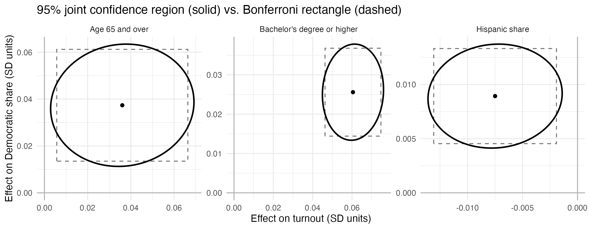
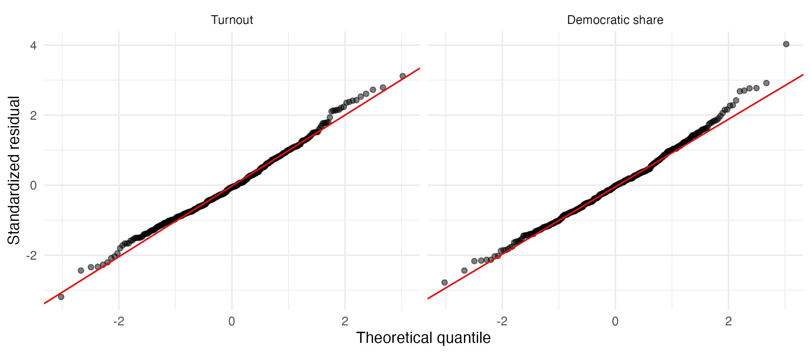
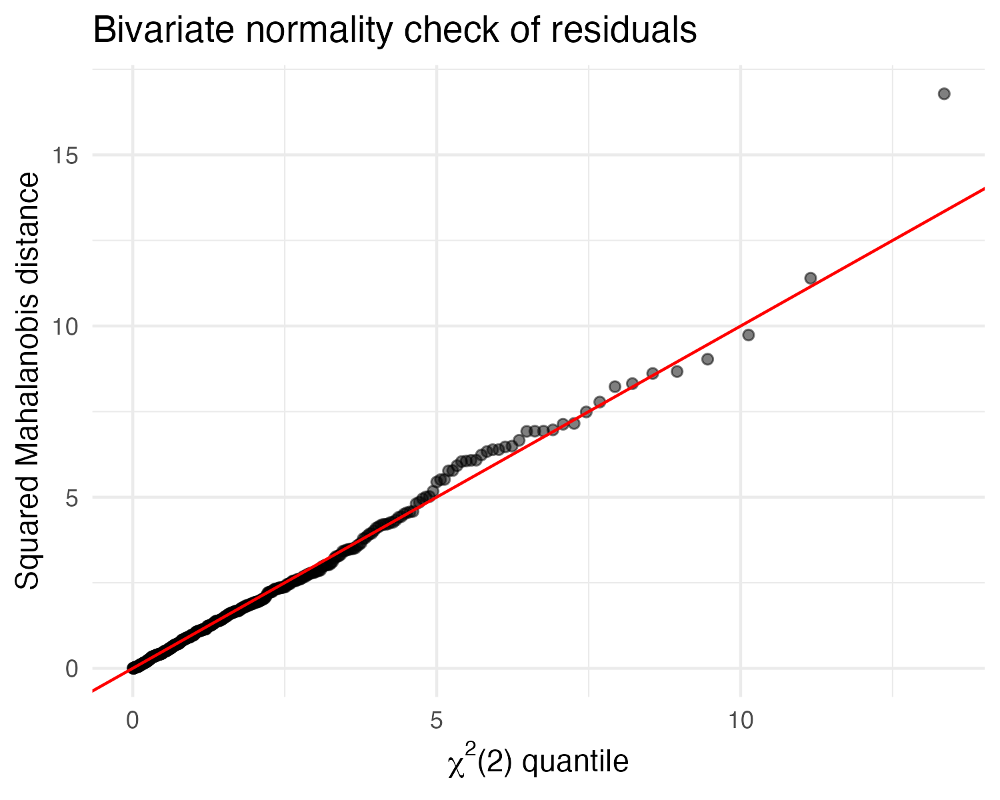

```{r}
#| label: setup
#| include: false
library(tidyverse)
```

## Introduction

Election outcomes can be evaluated as the result of the number of eligible citizens that voted and what proportion voted for the winning party. To evaluate this question, results of the 2024 House elections were analyzed to ask two questions:

1.  Which district characteristics are associated with turnout and Democratic two-party share, taken together?
2.  For each characteristic, is its association with turnout the same size as its association with Democratic share?

The analysis fits a multivariate, multiple regression with both outcomes and compares it with two separate regressions. The comparison shows when the joint model changes the conclusions and when it does not.

## Data

The unit of analysis is the congressional district for the 119th Congress who were elected in November 2024 and in which the democrats netted an additional two seats to reach 215 while Republicans retained control with 220 seats[@wiki_house_stats].

The data set used was aggregated from two primary data sources:

- **Election returns**: Obtained from the 2022 and 2024 from the MIT Election Data + Science Lab. The 2022 results identify incumbents [@MIT_house].
- **Demographic and economic estimates**: Obtained from the Census Bureau's American Community Survey (ACS) 5-year estimates, 2020–2024 [@census_acs5] as well the Census Bureau's 2024 Gazetteer file, used to compute population density [@census_gazetteer].

The two outcome variables were turnout which is calculcated as the number of votes cast in the House race divided by the citizen voting-age population in each district and Democratic share calculated as Democratic votes divided by the sum Democratic and Republican votes.

The model uses 396 of the 435 districts, excluding 39 districts with uncontested seats so two-party share is undefined. The predictor variables include racial demographics, educational level, median household income, gini coefficient of income distribution, estimated population density, percent female, age distribution and incumbent party. More details on each of the variables is available in the Appendix.

The sample has 170 districts with a Democratic incumbent, 177 with a Republican incumbent and 49 open seats. The non-Hispanic White share is left out because it is nearly a linear combination of the other race shares. Three other economic measures (low-income share, high-income share, poverty rate) are left out for collinearity.

Descriptive statistics are shown in @tbl-descriptives which shows the correlation between turnout and Democratic share is −0.19, indicating that Democratic districts tend to have somewhat lower turnout. Female share is consistent across all districts providing the model little information with which to detect an effect.

```{r}
#| label: tbl-descriptives
#| tbl-cap: "Descriptive statistics for study variables"
#| echo: false
#| message: false
descriptives <- read.csv("output/descriptives.csv", check.names = FALSE)

knitr::kable(descriptives, digits = 2)
```

## 3. Methods

### Multivariate multiple regression

Both outcomes are regressed on the same twelve predictors in one model:

$$
\mathbf{Y}_{n \times 2} = \mathbf{X}_{n \times 13}\,\mathbf{B}_{13 \times 2} + \mathbf{E},
\qquad
\boldsymbol{\varepsilon}_i \sim N_2(\mathbf{0}, \boldsymbol{\Sigma})
$$
Each row of Y holds one district's turnout and Democratic share. The coefficient matrix B has one column per outcome. Since both equations use the same predictors, the estimates of \Beta\ are identical to those from the separate OLS regressions. The joint model adds the error covariance matrix Σ, allowing the district's turnout and share errors to be correlated with tests that use both outcomes at once.

### Significance tests

Two approaches are compared for each predictor:

- **Separate tests:** a t-test in each univariate regression, with a Bonferroni-adjusted level of 0.05 / 2 = 0.025 because each predictor is tested twice.
- **Joint test:** Pillai's trace for H₀: the predictor's coefficients on turnout and on share are both zero, with its F approximation on 2 and 382 degrees of freedom.

### Cross-outcome tests

To ask whether a predictor moves turnout and Democratic share by the same amount, both outcomes are standardized (mean 0, SD 1) and the model is refit. For each predictor the test is H₀: β_turnout = β_share, using the response contrast (1, −1). Rejection means the predictor's effect, in SD units, differs between the outcomes.

### Joint confidence regions

For three predictors, the 95% joint confidence ellipse for the pair (β_turnout, β_share) from Hotelling's T² is compared with the Bonferroni rectangle formed by two 97.5% intervals.

### Robustness checks

- **State-clustered standard errors:** districts in one state share election law, ballot design and statewide races, so their errors may be correlated. Univariate coefficients are re-tested with standard errors clustered by state (48 clusters).
- **Poverty in place of inequality:** the model is refit with the poverty rate instead of the Gini index.
- **Missing-data cost:** the turnout regression is refit on all 433 districts with valid vote counts, including uncontested ones, to see how excluding them changes the estimates.

All analysis was done in R with the tidyverse, car, sandwich, lmtest and broom packages.

## Results

### Overall fit

The predictors explain 70.9% of the variation in turnout (adjusted R² = 0.700; F(12, 383) = 77.9, p \< 0.001) and 82.0% in Democratic share (adjusted R² = 0.814; F(12, 383) = 145.5, p \< 0.001). The joint test that all twelve predictors have no effect on either outcome is decisively rejected (Pillai's trace = 1.51; F(24, 766) = 97.7, p \< 0.001).

### Coefficients and joint tests

Coefficients are in percentage points of the outcome per one-unit change in the predictor. For example, a district with 10 more points of college graduates has 5.2 points higher turnout and 4.0 points higher Democratic share, other predictors held equal.

```{r}
#| label: tbl-testcompare
#| tbl-cap: "Comparative statistical test results"
#| echo: false
#| message: false
descriptives <- read.csv("output/test_comparison.csv", check.names = FALSE)

knitr::kable(descriptives, digits = 2)
```

Key patterns:

- **Education** has the largest joint effect (Pillai = 0.23) and raises both outcomes.
- **Race and ethnicity:** Black share is tied to Democratic share but not turnout. Asian and Hispanic shares raise Democratic share but lower turnout.
- **Income inequality** (Gini) lowers turnout by 0.9 points per index point, with no detectable effect on share.
- **Median income** has no effect on either outcome once education and inequality are controlled.
- **Age:** a younger electorate lowers turnout and raises Democratic share; an older one raises both.
- **Density:** each tenfold increase in density lowers turnout by 1.4 points and raises Democratic share by 3.8 points.
- **Incumbency** shifts Democratic share by about 9 points in the incumbent's party's favor, relative to open seats, with no effect on turnout.

### Joint versus separate tests

The two approaches agree for eleven of twelve predictors: ten are significant both ways and median income is significant neither way. The exception is **pct_female**: it misses the Bonferroni level in both separate regressions (p = 0.164 and 0.033, against 0.025) but is jointly significant (p = 0.046). Both effects are negative and, combined, give just enough evidence to clear 0.05. Given the small spread of this variable and the p-value close to the threshold, this result should be treated as weak.

### Do predictors affect turnout and share equally?

On standardized outcomes, nine of twelve predictors have significantly different effects on turnout and Democratic share (p \< 0.001 for each).

```{r}
#| label: tbl-cross_outcome
#| tbl-cap: "Comparative statistical test results"
#| echo: false
#| message: false
descriptives <- read.csv("output/cross_outcome_tests.csv", check.names = FALSE)

knitr::kable(descriptives, digits = 2)
```

SD change in each outcome per one-unit change in the predictor.

Asian share, young voters and density push the outcomes in opposite directions. Education raises turnout more than twice as much as share; inequality affects only turnout; race shares and incumbency mainly affect share. Only the 65+ share (and the weak female-share effect) moves both outcomes by the same amount.

### Residual correlation and joint confidence regions

After the predictors are accounted for, turnout and Democratic share residuals are almost uncorrelated (r = 0.054, p = 0.29), compared with a raw correlation of −0.19. The predictors explain nearly all of the association between the outcomes.

```{r}
#| label: fig-ellipses
#| fig-cap: "95% joint confidence region (solid) and Bonferroni rectangle (dashed) for three predictors, standardized outcomes."
#| fig-alt: "95% joint confidence regions (solid) vs. Bonferroni rectangles (dashed) for pct_65plus, pct_ba and pct_hisp, in SD units of each outcome."
#| echo: false
#| out-width: "100%"

```

Figure 1 shows the consequence. With little residual correlation, the joint 95% ellipses are almost untilted and track the Bonferroni rectangles closely. For all three predictors shown, both regions exclude zero on both axes, so the conclusions are the same either way.

## 5. Model diagnostics

The model's assumptions hold reasonably well; the main concerns are a few outlying districts and moderate collinearity between income and education.

### Normality

```{r}
#| label: fig-qq_plots
#| fig-cap: "Normal Q-Q plots of Standardized Residuals"
#| echo: false
#| out-width: "100%"

```

Both outcomes' residuals follow the normal line closely, with slightly heavy upper tails. The largest standardized residual is 4.0 (OR-3, Democratic share).

```{r}
#| label: fig-bivariate_qq_plots
#| fig-cap: "Bivariate normality check: squared Mahalanobis distances vs. χ²(2) quantiles"
#| echo: false
#| out-width: "100%"

```

The squared Mahalanobis distances of the residual pairs track the χ²(2) line, supporting bivariate normality. There is a slight bulge between quantiles 5 and 7 and one clear outlier at 16.8, again OR-3.

### Outliers

Ten districts exceed the 97.5% χ²(2) cutoff of 7.38, almost exactly the 9.9 expected by chance among 396. Five more are outliers on one outcome only (\|standardized residual\| \> 2.5).

```{r}
#| label: tbl-outliers
#| tbl-cap: "Outlier Districts"
#| echo: false
#| message: false
descriptives <- read.csv("output/outliers.csv", check.names = FALSE)

knitr::kable(descriptives, digits = 2)
```

## Discussion

### What the results say about districts

The main finding is that turnout and partisanship respond to different district characteristics. Democratic party share follows race, density, age and incumbency. Turnout follows education, inequality and the Asian and young-adult shares of the electorate. Only education strongly raises both.

Several predictors pull the two outcomes in opposite directions. Dense, younger and more Asian districts vote more Democratic but have lower turnout. This helps explain the negative raw correlation between turnout and Democratic share (−0.19): it is a product of where Democratic-leaning groups live, not a direct link between the outcomes.

Income inequality's effect on turnout, independent of median income and education, is one of the more notable results. Districts with a wider income gap turn out less, with no matching shift in party share. The poverty-rate model gives the same picture, so this is not specific to the Gini measure.

The incumbency effect of about 9 points should not be read as a pure incumbency advantage. Incumbents hold seats their party already wins, and the model has no measure of prior partisanship, so much of this effect reflects the district's underlying lean.

### What the multivariate approach added

For this data, the joint model changed significance conclusions only for the female share, a weak effect. The reason is the near-zero residual correlation (r = 0.05): once the predictors are controlled, the outcomes carry almost no shared unexplained variation, so joint tests reduce nearly to separate ones. This is itself a result: it shows that the observed link between turnout and share is accounted for by district composition.

The joint framework was still valuable for the cross-outcome tests. Testing whether a predictor's effects on turnout and share are equal requires both outcomes in one model, and that test separated predictors that affect participation from those that affect partisanship.


## Limitations

- **Observational, district-level data.** The results describe associations across districts, not causes, and not individual voters' behavior. A district with more college graduates turning out more does not show that graduates themselves vote more.
- **No measure of prior partisanship.** Without past presidential or House vote, the incumbency and demographic coefficients absorb part of each district's established partisan lean.
- **Excluded districts.** The 39 uncontested districts are not a random subset; they are concentrated in a few states and in strongly partisan areas. The turnout model's estimates shift when they are included (Section 4.6), so results apply to contested districts.
- **Correlated errors within states.** Clustered standard errors weaken several turnout effects, and the Pillai tests do not account for clustering.
- **Measurement.** ACS figures are 2020–2024 averages with sampling error, and the period includes the pandemic. Turnout uses House votes, which miss voters who skipped the House race.
- **Omitted economic conditions.** Unemployment is not included.
- **Collinearity** between education and income makes their separate effects hard to distinguish.
- **Outliers.** OR-3 is an extreme joint outlier; its influence on the estimates was not tested.

## Conclusion

In the 2024 House elections, district characteristics explained most of the variation in both turnout (71%) and Democratic share (82%). Education, race and ethnicity, age, density, inequality and incumbency were all jointly significant, while median income was not once education was controlled. Most predictors affected the two outcomes by different amounts or in opposite directions, separating the drivers of participation from those of partisanship. Because the outcomes' residuals were nearly uncorrelated, the multivariate and separate-regression approaches reached the same conclusions for all but one weak effect; the multivariate model's main contribution was the ability to test cross-outcome differences directly. Adding prior partisanship and unemployment, and accounting for state clustering in the joint tests, are the natural next steps.

\newpage

## Appendix: Predictor Variables

All shares are percentages of the citizen voting-age population unless noted.

| Variables | Description |
|----|----|
| pct_black, pct_hisp, pct_asian | Share of CVAP that is Black, Hispanic, Asian |
| pct_ba | Share of adults with a bachelor's degree or higher |
| inc_10k | Median household income, \$10,000s |
| gini | Gini index of household income × 100 |
| pct_18_29, pct_65plus | Share of CVAP aged 18–29 and 65+ |
| pct_female | Share of CVAP that is female |
| log_density | Share of CVAP that is female |
| inc_dem, inc_rep | Democratic or Republican incumbent running (open seat = baseline) |

\newpage