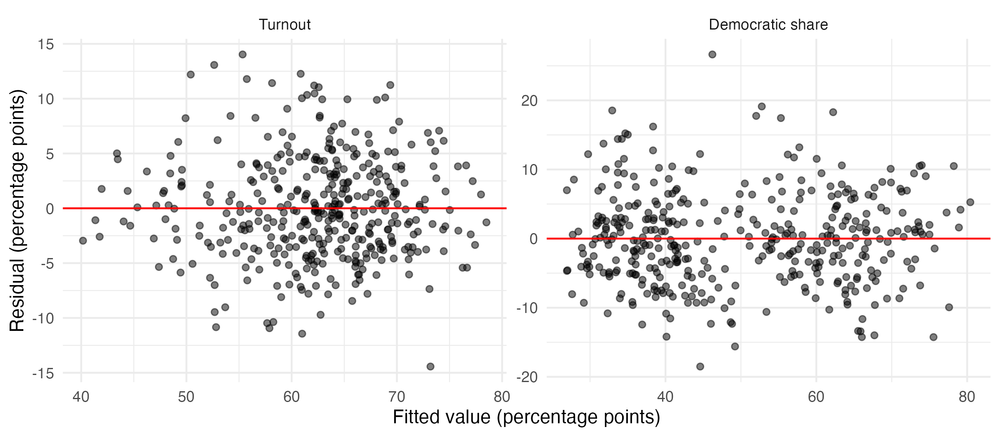
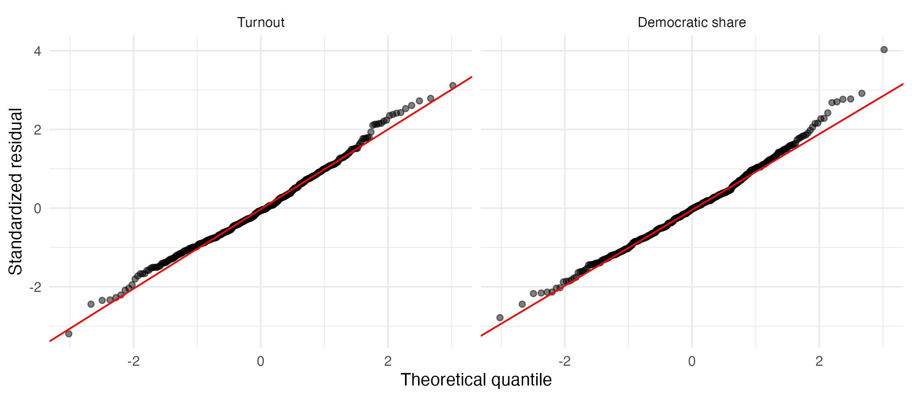
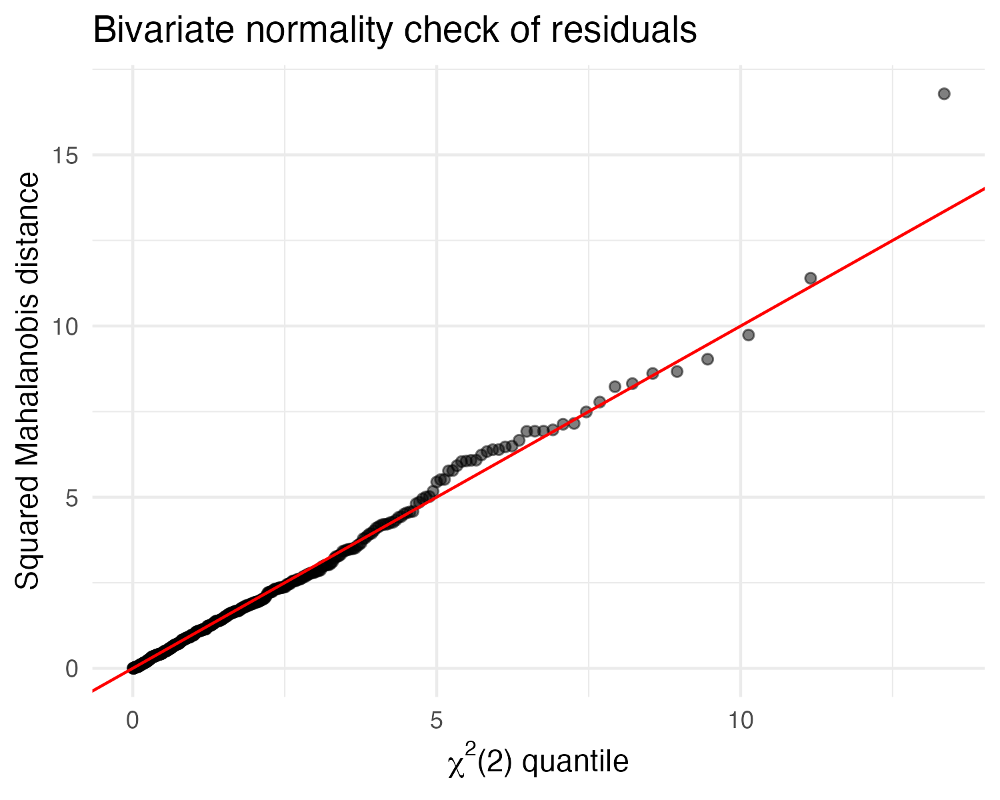

```{r}
#| label: setup
#| include: false
library(tidyverse)
```

## Introduction

Politics has become far more polarized in this century, contributing to greater political instability as exemplified by the fact that House majority changed four times in the last 25 years compared to only once in the previous 25 years [@wiki_house_stats].

In light of increased political uncertainty, this paper seeks to evaluate the drivers of voter behavior. The number of votes for a particular candidate can be viewed as a function of the proportion of eligible voters that turnout to vote and the percent of the votes cast for each party. To investigate potential drivers of these factors, the following research questions will be investigated:

- Which district characteristics are associated with turnout and two-party share?
- Are these factors impacted the same by each of these characteristics?

Much research in political science has investigated these questions separately by running univariate regression models, which implicitly assumes that voter turnout and share are independent. To evaluate if this is the case, a multivariate regression model is employed to measure the potential association between voter turnout and share and to test the joint effect of each predictor on each of these variables.

Data used is from the 119th Congress who were elected in November 2024. Election return data was obtained from the MIT Election Data + Science Lab [@MIT_house], demographic characteristics of each House district were obtained from the Census Bureau's American Community Survey (ACS) 5-year estimates (2020-2024) [@census_acs5] and the Census Bureau's 2024 Gazetteer file [@census_gazetteer].

Results suggest that voter turnout and Democractic share respond differently to each of the predictor variables. The null hypothesis of no difference was rejected with high level of significance (p\<0.001) using Pillai's trace. The model also explained most of the variation in voter turnout (70.9%) and Democratic share (82%).

In the remainder of this paper, the dataset is explained, methods for modeling and evaluating results are summarized and is concluded with a discussion of the implications and potential follow on research.

## Data

The unit of analysis is the congressional district for the 119th Congress in which the democrats netted an additional two seats to reach 215 while Republicans retained control with 220 seats[@wiki_house_stats]. The two outcome variables are Turnout calculcated as the number of votes cast in the House race divided by the citizen voting-age population and Democratic Share calculated as Democratic votes divided by the sum Democratic and Republican votes.

The model uses 396 of the 435 districts, excluding 39 districts with uncontested seats so two-party share is undefined. The predictor variables include racial, educational, income and gender demographics and incumbent party for each district (see Appendix for details). The non-Hispanic White share is left out because it is nearly a linear combination of the other race shares. Three other economic measures (low-income share, high-income share, poverty rate) are left out due to collinearity.

Descriptive statistics are shown in @tbl-descriptives which shows the correlation between turnout and Democratic share is −0.19, indicating that Democratic districts tend to have somewhat lower turnout. Female share is consistent across all districts providing the model little information with which to detect an effect.

```{r}
#| label: tbl-descriptives
#| tbl-cap: "Descriptive statistics for study variables"
#| echo: false
#| message: false
descriptives <- read.csv("output/descriptives.csv", check.names = FALSE)

knitr::kable(descriptives, digits = 2)
```

## Methods

Both outcomes are regressed on the same twelve predictors in one model:

$$
\mathbf{Y}_{n \times 2} = \mathbf{X}_{n \times 13}\,\mathbf{B}_{13 \times 2} + \mathbf{E},
\qquad
\boldsymbol{\varepsilon}_i \sim N_2(\mathbf{0}, \boldsymbol{\Sigma})
$$ Each row of Y holds one district's turnout and Democratic share. The coefficient matrix B has one column per outcome. Since both equations use the same predictors, the estimates of \Beta are identical to those from the separate OLS regressions. The joint model adds the error covariance matrix Σ, allowing the district's turnout and share errors to be correlated with tests that use both outcomes at once.

All analysis was done in R with the tidyverse, car, sandwich, lmtest and broom packages.

## Results

Separate tests are used to evaluate the univariate and bivariate models.

- **Univariate:** A t-test is applied for each of the separate regressions applying a Bonferroni-adjusted level of 0.05 / 2 = 0.025 to account for multiple testing. Overall, the model fits the data well as the predictors explain 70.9% of the variation in turnout (adjusted R² = 0.700; F(12, 383) = 77.9, p \< 0.001) and 82.0% in Democratic share (adjusted R² = 0.814; F(12, 383) = 145.5, p \< 0.001).
- **Bivariate:** Pillai's trace for the null hypothesis that the predictor's coefficients on turnout and on share are both zero. The joint test that all twelve predictors have no effect on either outcome is decisively rejected (Pillai's trace = 1.51; F(24, 766) = 97.7, p \< 0.001).

To determine whether a predictor moves turnout and Democratic share by the same amount, both outcomes are standardized (mean 0, SD 1). For each predictor, the test is H₀: β_turnout = β_share, using the response contrast (1, −1). Rejection means the predictor's effect, in SD units, differs between the outcomes.

Multivariate regression requires that the error terms associated with each dependent variable are independent, a constant covariance matrix and that the multiviariate errors $\boldsymbol{\varepsilon}_i \sim N_2(\mathbf{0}, \boldsymbol{\Sigma})$. The large sample size (n=396) helps to ensure that some deviation from normal will still provide robust test statistics.

Coefficients are explained in percentage points of the outcome per one-unit change in the predictor. For example, a district with 10 more points of college graduates has 5.2 points higher turnout and 4 points higher Democratic share, assuming other predictors are held equal. @tbl-coefficients summarizes the univariate t-test results and bivariate Pillai tests for each of the predictors.

```{r}
#| label: tbl-coefficients
#| tbl-cap: "Separate regression coefficients and multivariate joint tests (classical SEs, n = 396)"
#| echo: false
#| message: false

library(kableExtra)

coefs <- read.csv("output/exhibits/coefficients.csv", check.names = FALSE)

knitr::kable(coefs, format = "latex", booktabs = TRUE) |>
  kable_styling(font_size = 8, latex_options = c("hold_position", "scale_down"))
```

Having determined how predictor variables are significant between the two variables, the next question answered is how the predictor variables impact Turnout and Democratic share. @tbl-outcome-test summarizes the results by predictor. Nine of the twelve variables show meaningfully different impacts on the outcome variables while income, senior voter percent and percent female voters are not meaningfully different between the models. Four of the significant variables also have opposing signs

```{r}
#| label: tbl-outcome-test
#| tbl-cap: "Cross Outcome Tests"
#| echo: false
#| message: false
descriptives <- read.csv("output/cross_outcome.csv", check.names = FALSE)

knitr::kable(descriptives, digits = 3)
```
One of the limitations of the multivariate regression model are the strong assumptions that are required. Analysis suggests that the data reasonably meets the requirements. @fig-residuals-fitted shows the plots for residuals and Turnout versus fitted values show no particular correlation and are broadly constant for Democratic share. Neither plot shows significant curvature or a funnel though there is some clustering of Democratic share below and above 50% reflecting the effect of democratic incumbency, but the spread of residuals is similar in both clusters.

```{r}
#| label: fig-residuals-fitted
#| fig-cap: "Bivariate normality check: squared Mahalanobis distances vs. χ²(2) quantiles"
#| echo: false
#| out-width: "100%"

```

Normality of the residuals contributes to the robustness of t-tests. @fig-qq-plots shows the standardized residuals against theoretical normal quantiles. These results suggest the data is slightly heavy tailed on each tail but overall appear to be reasonably close to normal considering the large sample sizes. @fig-bivariate-qq-plots tests whether each district's pair of errors for turnout and Democratic share are bivariate normal by plotting the squared Mahalonobis distance compared to the hypothetical chi-square distribution. Visual inspection shows the residuals are closely aligned with chi-square and with heavier tails and a few outliers. The large sample size allows for some moderate departure so this assumption appears to be reasonably met so the Pillai test results are robust.

```{r}
#| label: fig-qq-plots
#| fig-cap: "Normal Q-Q plots of Standardized Residuals"
#| echo: false
#| out-width: "100%"

```

```{r}
#| label: fig-bivariate-qq-plots
#| fig-cap: "Bivariate normality check: squared Mahalanobis distances vs. χ²(2) quantiles"
#| echo: false
#| out-width: "60%"
#| fig-align: center

```

## Discussion

The main finding of the analysis is that Turnout and Democratic share respond to differently to district explanatory variables. Democratic party share follows race, density, age and incumbency. Turnout follows education, inequality and the Asian and young-adult shares of the electorate. Only education strongly raises both.

Several predictors pull the two outcomes in opposite directions. Dense, younger and more Asian districts vote more Democratic but have lower turnout. This helps explain the negative correlation between turnout and Democratic share (−0.19): it is a product of where Democratic-leaning groups live, not a direct link between the outcomes.

Income inequality's effect on turnout, independent of median income and education, is one of the more notable results. Districts with a wider income gap turn out less, with no matching shift in party share. The poverty-rate model gives the same picture, so this is not specific to the Gini measure.

The incumbency effect of about 9 points should not be read as a pure incumbency advantage. Incumbents hold seats their party already wins, and the model has no measure of prior partisanship, so much of this effect reflects the district's underlying lean.

The joint model was still valuable for the cross-outcome tests. Testing whether a predictor's effects on turnout and share are equal requires both outcomes in one model, and that test separated predictors that affect participation from those that affect partisanship.

The results from this model are limited since the data are based on 2020-2024 averages with sampling error measured at the district level and not individual level behavior. For example, districts with more college graduates does not indicate that more college graduates actually voted. This time period also includes the pandemic, which may have affected measured averages as well. The data also omits some key variables such as prior partisanship and unemployment rate by district, which could improve the explanatory power of the model.

In the 2024 House elections, district characteristics explained most of the variation in both turnout (71%) and Democratic share (82%). Education, race and ethnicity, age, density, inequality and incumbency were all jointly significant. Most predictors affected the two outcomes by different amounts or in opposite directions, separating the drivers of participation from those of partisanship. Because the outcomes' residuals were nearly uncorrelated, the multivariate and separate-regression approaches reached the same conclusions for all but one weak effect; the multivariate model's main contribution was the ability to test cross-outcome differences directly. 

\newpage

## Appendix: Predictor Variables

| Variable | Label | Short Label | Definition |
|-------------|-----------------|----------------|---------------------------|
| turnout | Turnout % | Turnout | House votes cast as a share of CVAP |
| dshare | Democratic two-party share (%) | Democratic share | Democratic votes / (Democratic + Republican votes) |
| pct_black | Black share (%) | Black share | Share of CVAP that is Black |
| pct_hisp | Hispanic share (%) | Hispanic share | Share of CVAP that is Hispanic |
| pct_asian | Asian share (%) | Asian share | Share of CVAP that is Asian |
| pct_ba | Bachelor's degree of higher (%) | Bachelor's degree of higher | Share of adults with bachelor's degree of higher |
| inc_10k | Median household income | Median household income | Median household income in \$10,000s |
| gini | Income inequality (Gini index x 100) | Income inequality | Gini index of household income, times 100 |
| pct_18_29 | Ages 18-29 (%) | Age 18-29 | Share of CVAP aged 18-29 |
| pct_65plus | Age 65 and over (%) | Age 65 and over | Share of CVAP aged 65 and older |
| pct_female | Female share (%) | Female share | Share of CVAP that is female |
| log_density | Population density (log10) | Population density | Log base 10 of persons per square mile |
| inc_dem | Democratic incumbent | Democratic incumbent | 1 if a Democratic incumbent ran (open seat = baseline) |
| inc_rep | Republican incumbent | Republican incumbent | 1 if a Republican incumbent ran (open seat = baseline) |
| pct_poverty | Poverty rate (%) | Poverty rate | Share of people below the poverty line |
| pct_low_inc | Low-income households (%) | Low-income households | Share of households with low income |
| pct_high_inc | High-income households (%) | High-income households | Share of households with high income |

\newpage
