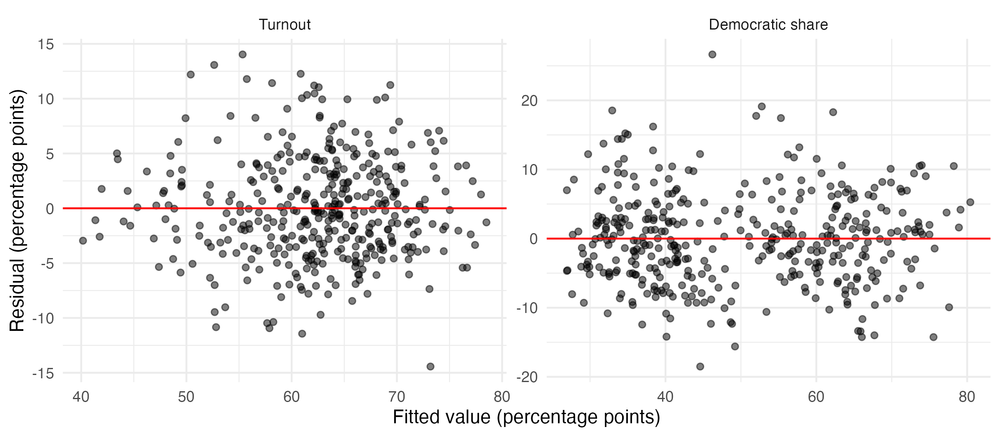
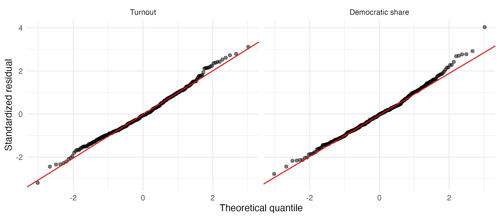
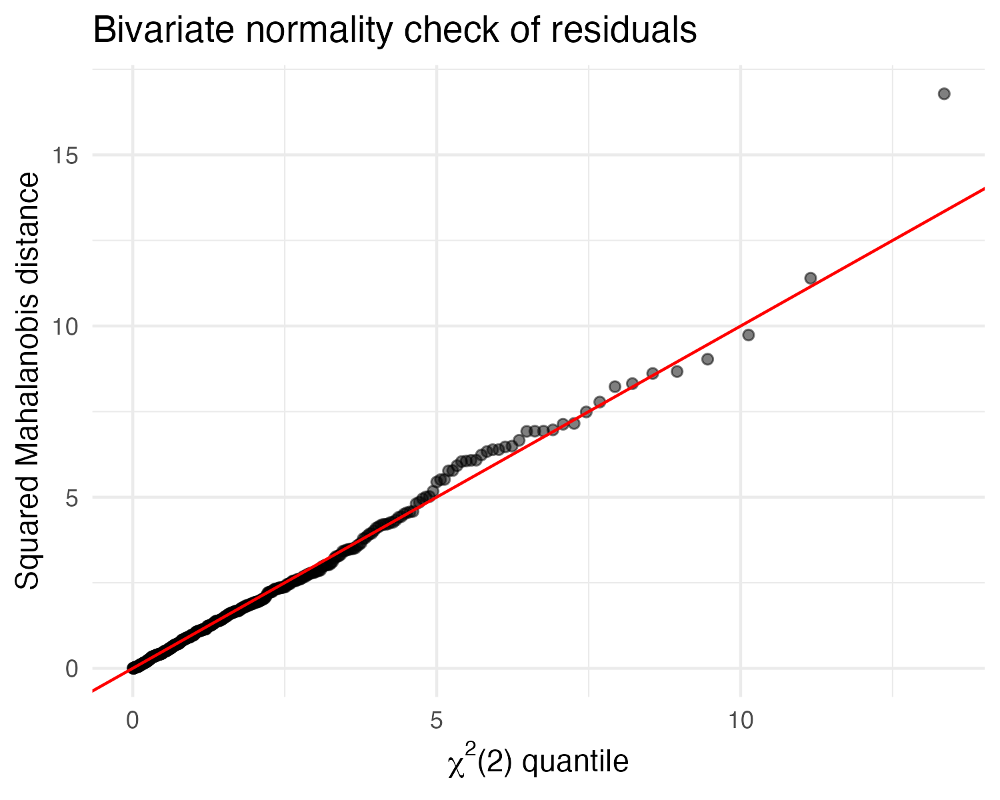

```{r}
#| label: setup
#| include: false
library(kableExtra)

# One style for every table in the report
style_table <- function(df, font_size = 9, scale_down = FALSE) {
  knitr::kable(df, format = "latex", booktabs = TRUE) |>
    kable_styling(font_size = font_size,
                  latex_options = c("hold_position", if (scale_down) "scale_down"))
}
```

## Introduction

Politics has become far more polarized in this century as demonstrated by the increased frequency in changing party majorities in the House: changing four times in the last 25 years compared to only once in the previous 25 years [@wiki_house_stats].

In light of this increased political volatility, this paper evaluates the congressional district demographic characteristics and their potential association with voting outcomes. The number of votes for a party's candidate can be viewed as a function of two outcomes: the proportion of eligible voters who turn out to vote, and the share of votes cast for each party. To investigate potential drivers of these outcomes, the following research questions are investigated:

- Which district characteristics are associated with turnout and Democratic two-party share, taken together?
- Do thse characteristics impact voter turnout and party share to the same degree?

Much political science research has investigated these questions separately, using univariate regression models, ignoring any correlation between turnout and vote share. To evaluate whether modeling the outcomes jointly provides additional insights, a multivariate regression model is used to estimate the correlation between the two outcomes' errors and to test the joint effect of each predictor on both outcomes, comparing results of the univariate models.

The data cover the 2024 House elections, which elected the 119th Congress. Election returns were obtained from the MIT Election Data + Science Lab [@MIT_house], demographic and economic characteristics of each district were obtained from the Census Bureau's American Community Survey (ACS) 5-year estimates (2020–2024) [@census_acs5], and land area from the Census Bureau's 2024 Gazetteer file [@census_gazetteer].

The results suggest that turnout and voter share (measured as Democratic share) respond differently to district characteristics. The predictors explain most of the variation in turnout (70.9%) and Democratic share (82.0%), and the joint test that no predictor is associated with either outcome is rejected using Pillai's trace (p \< 0.001). Nine of the twelve predictors are associated with the two outcomes by significantly different amounts. The residual correlation between the outcome is near zero so that individual and joint models reach the same conclusion for 11 of 12 predictors (exception is female share). The joint model provides greater insight into how predictor variables have different impacts on turnout and voter share.

The remainder of this paper describes the data, summarizes the methods used to model and evaluate the outcomes, presents the results, and concludes with a discussion of their implications and potential follow-on research.

The data and code are publicly available.[^repo]

[^repo]: All R scripts, data and report files are available at
    <https://github.com/janblackbu69/Math257>.

## Data

The unit of analysis is the congressional district, using the 119th Congress districts from the November 2024 election, in which Democrats gained a net two seats to reach 215 while Republicans retained control with 220 seats [@wiki_house_stats]. The two outcome variables are turnout, calculated as the number of votes cast in the House race divided by the citizen voting-age population (CVAP), and Democratic share, calculated as Democratic votes divided by the sum of Democratic and Republican votes.

The model uses 396 of the 435 districts, excluding 39 uncontested districts in which two-party share is undefined since these districts were uncontested. The predictor variables describe the racial, educational, income, age and gender composition of each district, its population density and the party of the incumbent (see Appendix A for definitions). The non-Hispanic White share is left out because it is nearly a linear combination of the other race shares. Three other economic measures (low-income share, high-income share and poverty rate) are left out due to collinearity with median income. Incumbency comes from 2022 results with 170 Democratic incumbents, 177 Republican incumbents and 49 open seats (baseline). The excluded 39 districts are concentrated in Massachusetts (7 districts), Texas (8 districts) and California (2 districts). No districts were dropped for missing Census data.

Descriptive statistics are shown in @tbl-descriptives. The correlation between turnout and Democratic share is −0.19, indicating that Democratic districts tend to have lower turnout. The female share varies little across districts (SD = 1.2 percentage points), which gives the model little information with which to detect its effect.

```{r}
#| label: tbl-descriptives
#| tbl-cap: "Descriptive statistics for the outcome and predictor variables (n = 396 contested districts)"
descriptives <- read.csv("output/exhibits/descriptives.csv", check.names = FALSE)
style_table(descriptives)
```

## Methods

### Univariate models

This approach fits a separate multiple regression for each outcome $k$, where $k = T$ for turnout and $k = D$ for Democratic share:

$$
\mathbf{y}_k = \mathbf{X}\boldsymbol{\beta}_k + \boldsymbol{\epsilon}_k,
\qquad
\boldsymbol{\epsilon}_k \sim N_n(\mathbf{0}, \sigma_k^2 \mathbf{I}_n),
\qquad k \in \{T, D\}
$$ {#eq-univariate}

- $\mathbf{y}_k$ is a list of one outcome’s values, one number per district. For turnout ($k = T$), it holds every district’s turnout; for Democratic share ($k = D$), every district’s Democratic share.

- $\mathbf{X}$ is the table of predictor values, with one row per district and 13 columns. The first column is all 1s to model estimate an intercept (the baseline level of the outcome). The other 12 columns hold the predictors, such as Black share, education and density.

- $\boldsymbol{\beta}_k$ is the list of 13 coefficients for outcome $k$: the intercept plus one coefficient per predictor. Each coefficient says how much the outcome changes when that predictor goes up by one unit, holding the others fixed.

- $\boldsymbol{\epsilon}_k$ is the part of each district’s outcome the predictors don’t explain. The model assumes these errors are independent from district to district, follow a normal distribution, and have the same variation ($\sigma_k^2$) across districts.

### Multivariate model

The multivariate model regresses both outcomes on the same twelve predictors at once:

$$
\mathbf{Y}_{n \times 2} = \mathbf{X}_{n \times 13}\,\mathbf{B}_{13 \times 2} + \mathbf{E},
\qquad
\boldsymbol{\varepsilon}_i \sim N_2(\mathbf{0}, \boldsymbol{\Sigma}),
\qquad
\boldsymbol{\Sigma} =
\begin{pmatrix}
\sigma_T^2 & \sigma_{TD} \\
\sigma_{TD} & \sigma_D^2
\end{pmatrix}
$$ {#eq-mvreg}

Each row of $\mathbf{Y}$ holds one district's turnout and Democratic share, and $\boldsymbol{\varepsilon}_i$ is the $i$th row of $\mathbf{E}$. The coefficient matrix $\mathbf{B}$ has one column per outcome. Because both equations use the same predictors, the estimates are identical to those from the two separate OLS regressions. The joint model adds the error covariance matrix $\boldsymbol{\Sigma}$, which allows a district's turnout and share errors to be correlated and makes possible tests that use both outcomes at once.

$\boldsymbol{\Sigma}$ is a 2×2 table describing the errors, the part of each outcome the predictors don’t explain:

$\sigma_T^2$ (top left) is the variance of the turnout errors: how far districts’ actual turnout typically lands from what the model predicts.
$\sigma_D^2$ (bottom right) is the same thing for Democratic share.
$\sigma_{TD}$ (both off-diagonal spots) is the covariance between the two errors. It describes whether a district that beats its predicted turnout also tends to beat, or fall short of, its predicted Democratic share. 

### Joint significance tests

For each predictor $j$, the joint test asks whether it is associated with either outcome, testing $H_0: (\beta_{jT}, \beta_{jD}) = (0, 0)$ with Pillai's trace [@johnson2007]:

$$
V = \operatorname{tr}\!\left[\mathbf{S}_H(\mathbf{S}_H + \mathbf{S}_E)^{-1}\right]
$$ {#eq-pillai}

For each predictor, the test is

$$
H_0: \beta^{*}_{jT} - \beta^{*}_{jD} = 0,
$$ {#eq-cross}

using the response contrast $\mathbf{c} = (1, -1)^\top$. Rejection means the predictor's effect differs between the outcomes.

Because turnout and Democratic share have different spreads, both are standardized to mean 0 and SD 1, so each coefficient ($\beta^*$) shows how many standard deviations an outcome moves per one-unit change in the predictor, putting the two outcomes on the same scale. The test then asks whether a predictor’s two standardized coefficients are equal, which is the same as regressing each district’s difference between its two standardized outcomes ($z_T - z_D$) on all the predictors and checking whether that predictor’s coefficient is zero; the F statistic is simply that coefficient’s t statistic squared. The test requires the covariance between the two coefficient estimates, which two separate regressions don’t provide, so it’s only possible when both outcomes are modeled together.

### Assumptions and diagnostics

Multivariate regression requires that the error vectors $\boldsymbol{\varepsilon}_i$ be independent across districts, that they share a constant covariance matrix $\boldsymbol{\Sigma}$, and that they be bivariate normal. The two errors within a district may be correlated as captured by $\boldsymbol{\Sigma}$. The large sample size ($n = 396$) means moderate departures from normality should still give reliable test statistics.

**Diagnostic checks:** Plots of residuals against fitted values check that the relationships are linear and that the errors have a similar spread everywhere; a curve or funnel shape signals violations in the constant variation assumption. Normal Q-Q plots of the standardized residuals check whether each outcome’s errors are normal, which they are if the points fall along a straight line. To check whether the two errors are jointly normal, each district’s pair of residuals is reduced to a single number, the squared Mahalanobis distance, which measures how unusual the pair is after accounting for each outcome’s spread and the correlation between them; if the errors are bivariate normal, these distances follow a chi-square distribution with 2 degrees of freedom, so plotting them against that distribution’s quantiles should also follow a straight line. 

**What to expect:** How much the multivariate model adds depends on the residual correlation between the outcomes. If that correlation is weak, the joint tests should give nearly the same answers as the separate tests. The joint test helps most when the correlation runs against the pattern of a predictor’s effects, for example, when a predictor raises both outcomes but their errors are negatively correlated. It can lose power when a predictor affects only one outcome, because it spreads its attention across both.

All analysis was done in R [@R_core] with the tidyverse [@tidyverse], car [@car], sandwich [@sandwich], lmtest [@lmtest] and broom [@broom] packages, and tables were formatted with kableExtra [@kableExtra].

## Results

### Model fit and joint tests

Overall, the models fit the data well. The predictors explain 70.9% of the variation in turnout (adjusted $R^2$ = 0.700; F(12, 383) = 77.9, p \< 0.001) and 82.0% in Democratic share (adjusted $R^2$ = 0.814; F(12, 383) = 145.5, p \< 0.001). The joint test that all twelve predictors have no effect on either outcome is decisively rejected (Pillai's trace = 1.51; F(24, 766) = 97.7, p \< 0.001).

Coefficients are expressed in percentage points of the outcome per one-unit change in the predictor. For example, a district with 10 more percentage points of college graduates has 5.2 points higher turnout and 4.0 points higher Democratic share, holding the other predictors constant. @tbl-coefficients summarizes the separate t-tests and the joint Pillai test for each predictor.

```{r}
#| label: tbl-coefficients
#| tbl-cap: "Separate regression coefficients with t-test p-values, and joint Pillai tests for each predictor (classical standard errors, n = 396)"
coefs <- read.csv("output/exhibits/coefficients.csv", check.names = FALSE)
style_table(coefs, font_size = 8, scale_down = TRUE)
```

The joint and separate tests reach the same conclusion for 11 of the 12 predictors: ten are significant both ways but median income is insignificant. The one exception is the female share, which misses the Bonferroni cutoff in both separate tests (p = 0.164 and 0.033, against 0.025) but is jointly significant (p = 0.046), because its two negative effects together provide just enough evidence; given how little this variable varies and how close the p-value is to 0.05, it’s a weak result. The two approaches agree so closely because the residual correlation is nearly zero (r = 0.054, p = 0.29), compared with the raw correlation of −0.19, meaning the predictors explain almost all of the relationship between turnout and Democratic share. 

### Cross-outcome tests

Having identified which predictors are jointly significant, the hypothesis tested is whether each predictor is associated with turnout and Democratic share by the same amount or not. @tbl-outcome-test summarizes the results on the standardized outcomes. Nine of the twelve predictors have significantly different effects on the two outcomes (p \< 0.001), while the effects of median income, the 65-and-over share and the female share are not significantly different. Four predictors (Hispanic share, Asian share, the 18–29 share and population density) are significantly associated with both outcomes, but in opposite directions.

### Model diagnostics

One limitation of the multivariate regression model is the strong set of assumptions it requires, but the analysis suggests the data reasonably meet them. @fig-residuals-fitted (Appendix B) plots the residuals against the fitted values for each outcome. Neither panel shows curvature or a funnel shape. Fitted values for Democratic share fall into two clusters, below and above 50%, reflecting the shift of about 9 points associated with Democratic and Republican incumbents, but the spread of residuals is similar in both clusters.

Normality of the residuals supports the validity of the t-tests. @fig-qq-plots (Appendix B) compares the standardized residuals with theoretical normal quantiles. Both outcomes follow the normal line closely, with slightly heavy upper tails, but given the large sample size, these departures are unlikely to affect the results. @fig-bivariate-qq-plots tests whether each district's pair of errors for turnout and Democratic share is bivariate normal by plotting the squared Mahalanobis distances against the quantiles of the $\chi^2(2)$ distribution. The points track the reference line closely, with a slight bulge between quantiles 5 and 7 and only a single clear outlier. The bivariate normality assumption appears reasonably met, and the Pillai tests are unlikely to be distorted by non-normality given the large sample.

```{r}
#| label: tbl-outcome-test
#| tbl-cap: "Cross-outcome tests: effect of each predictor on standardized turnout and Democratic share (SD change per one-unit change in the predictor), with F tests of equal effects"
cross <- read.csv("output/exhibits/cross_outcome.csv", check.names = FALSE)
style_table(cross)
```

## Discussion

The main finding of the analysis is that turnout and Democratic share respond differently to district characteristics. Democratic share is associated with race, density, age and incumbency, while turnout is associated with education, inequality, and the Asian and young-adult shares of the electorate. Only education strongly raises both. Several predictors pull the two outcomes in opposite directions. Denser, younger and more Asian districts vote more Democratic but have lower turnout. This helps explain the negative correlation between turnout and Democratic share (−0.19): it is a product of where Democratic-leaning groups live, not a direct link between the outcomes.

For these data, the multivariate model added little to the significance tests. Because the residual correlation between turnout and Democratic share is nearly zero (r = 0.05), the joint tests gave almost the same answers as the separate regressions, changing the conclusion only for the weak female-share effect. That is itself an answer to the project’s question: when the outcomes’ unexplained parts are essentially unrelated, a multivariate model offers little benefit for testing which predictors matter. The joint model was still valuable for the cross-outcome tests, testing whether a predictor's effects on turnout and share are equal or not. 

The results have several limitations. The ACS data are 2020–2024 estimated averages with sampling error measured at the district level rather than for individual voters. For example, the finding that districts with more college graduates have higher turnout does not show that college graduates themselves are more likely to vote. This period also includes the pandemic, which may have affected the averages. The model also omits key variables, such as prior partisanship and district unemployment rates, which could improve its explanatory power. A final limitation is the districts in the same state are likely to have related errors since they share the same election rules which can result in clustered errors, resulting in standard errors and p-values that are too small.

Future research could add measures the model lacks, such as prior partisan vote and unemployment rates, adjust the Pillai tests for within-state correlation (for example, by resampling whole states in a bootstrap), or repeat the analysis for other election years to see whether the patterns hold.

In the 2024 House elections, district characteristics explained most of the variation in both turnout (71%) and Democratic share (82%). Education, race and ethnicity, age, density, inequality and incumbency were all jointly significant. Most predictors affected the two outcomes by different amounts or in opposite directions, separating the drivers of participation from those of partisanship. Because the outcomes' residuals were nearly uncorrelated, the multivariate and separate-regression approaches reached the same conclusions for all but one weak effect; the multivariate model's main contribution was the ability to test cross-outcome differences directly.

\newpage

## References {.unnumbered}

::: {#refs}
:::

\newpage

## Appendix A: Variable Definitions {.unnumbered}

CVAP is the citizen voting-age population. The last three variables were excluded from the model because of collinearity with median income.

| Variable | Label | Definition |
|----------------|-------------------------|-------------------------------|
| turnout | Turnout (%) | House votes cast as a share of CVAP |
| dshare | Democratic two-party share (%) | Democratic votes / (Democratic + Republican votes) |
| pct_black | Black share (%) | Share of CVAP that is Black |
| pct_hisp | Hispanic share (%) | Share of CVAP that is Hispanic |
| pct_asian | Asian share (%) | Share of CVAP that is Asian |
| pct_ba | Bachelor's degree or higher (%) | Share of adults with a bachelor's degree or higher |
| inc_10k | Median household income | Median household income, in \$10,000s |
| gini | Income inequality (Gini index × 100) | Gini index of household income, times 100 |
| pct_18_29 | Age 18–29 (%) | Share of CVAP aged 18–29 |
| pct_65plus | Age 65 and over (%) | Share of CVAP aged 65 and older |
| pct_female | Female share (%) | Share of CVAP that is female |
| log_density | Population density (log10) | Log base 10 of persons per square mile |
| inc_dem | Democratic incumbent | 1 if a Democratic incumbent ran (open seat = baseline) |
| inc_rep | Republican incumbent | 1 if a Republican incumbent ran (open seat = baseline) |
| pct_poverty | Poverty rate (%) (excluded) | Share of people below the poverty line |
| pct_low_inc | Low-income households (%) (excluded) | Share of households with low income |
| pct_high_inc | High-income households (%) (excluded) | Share of households with high income |

\newpage

## Appendix B: Diagnostic and Supplementary Figures {.unnumbered}

```{r}
#| label: fig-residuals-fitted
#| fig-cap: "Residuals vs. fitted values for turnout and Democratic share"
#| out-width: "100%"

```

```{r}
#| label: fig-qq-plots
#| fig-cap: "Normal Q-Q plots of standardized residuals for turnout and Democratic share"
#| out-width: "100%"

```


```{r}
#| label: fig-bivariate-qq-plots
#| fig-cap: "Bivariate normality check: squared Mahalanobis distances of the residual pairs vs. χ²(2) quantiles"
#| out-width: "60%"
#| fig-align: center

```
